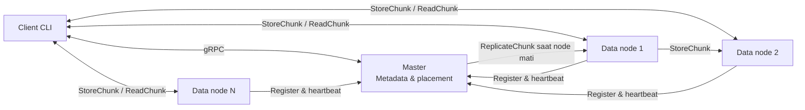

# SiliFS

> Mini *distributed file system* berbasis Python dan gRPC untuk menguji pengaruh strategi penempatan replika terhadap pemerataan beban, kinerja upload, dan pemulihan setelah kegagalan node.

SiliFS dibuat untuk Tugas Besar Komputasi Paralel dan Terdistribusi, Program Studi Informatika, Universitas Siliwangi — Tema 5: **Cloud-based Distributed File Storage (DFS-X)**.

## Daftar isi

- [Fitur](#fitur)
- [Arsitektur](#arsitektur)
- [Strategi penempatan replika](#strategi-penempatan-replika)
- [Prasyarat](#prasyarat)
- [Menjalankan tanpa Docker](#menjalankan-tanpa-docker)
- [Menggunakan Docker Compose](#menggunakan-docker-compose)
- [Monitoring](#monitoring)
- [Pengujian](#pengujian)
- [Eksperimen dan hasil](#eksperimen-dan-hasil)
- [Kubernetes (opsional)](#kubernetes-opsional)
- [Struktur proyek](#struktur-proyek)
- [Batasan dan pengembangan lanjut](#batasan-dan-pengembangan-lanjut)
- [Tim](#tim)

## Fitur

- Memecah file menjadi chunk berukuran 1, 4, atau 8 MB.
- Replikasi chunk dengan *replication factor* (RF) yang dapat dipilih.
- Tiga strategi penempatan replika: Random, Round-Robin, dan Capacity-Aware.
- Transfer antarkomponen menggunakan gRPC dengan batas pesan 16 MB.
- Verifikasi integritas chunk menggunakan checksum SHA-256.
- Heartbeat data node setiap 3 detik dan deteksi node mati setelah 30 detik tanpa heartbeat.
- *Failover* saat download: client mencoba replika hidup berikutnya bila suatu node tidak dapat dibaca.
- Re-replication otomatis untuk menggantikan replika yang hilang.
- Metrik operasi client dalam CSV dan dashboard monitoring Flask.
- Deployment Docker Compose untuk klaster 3, 5, dan 8 data node.
- Skrip otomatis untuk eksperimen dan pembangkitan grafik.

## Arsitektur



| Komponen | Tanggung jawab |
| --- | --- |
| Master | Menyimpan metadata file/chunk di memori, memilih lokasi replika, menerima heartbeat, mendeteksi node mati, dan memulai re-replication. |
| Data node | Menyimpan chunk ke disk lokal, mengecek kapasitas virtual dan checksum, mengirim heartbeat, serta menyalin chunk ke node tujuan. |
| Client | Meminta alokasi ke master, mengirim chunk ke seluruh replika, menggabungkan chunk saat download, dan mencatat metrik. |
| Monitoring | Menampilkan status node dari direktori data dan metrik client melalui dashboard Flask. |

### Alur upload, download, dan pemulihan

1. Client meminta rencana lokasi chunk kepada master melalui `AllocateChunks`.
2. Client memecah file, menghitung SHA-256 tiap chunk, lalu memanggil `StoreChunk` pada semua replika.
3. Jika seluruh chunk terkirim, client meminta `CommitFile`; metadata file kemudian dapat diakses untuk download.
4. Saat download, client meminta lokasi chunk dan mencoba replika secara berurutan hingga berhasil.
5. Jika heartbeat suatu node tidak diterima selama 30 detik, master menandainya mati dan menyuruh data node sumber menjalankan `ReplicateChunk` ke node pengganti.

## Strategi penempatan replika

| Strategi | Nilai CLI | Mekanisme |
| --- | --- | --- |
| Random | `random` | Memilih sejumlah RF node hidup secara acak. |
| Round-Robin | `round_robin` | Memilih node berurutan; titik awal bergeser satu node pada setiap chunk. |
| Capacity-Aware | `capacity_aware` | Mengutamakan node dengan sisa kapasitas virtual terbesar. |

## Prasyarat

Untuk menjalankan secara lokal:

- Python 3.12 atau versi Python 3 yang kompatibel.
- `pip` dan virtual environment (`venv`).
- Terminal PowerShell (contoh perintah di README ini memakai PowerShell).

Untuk deployment kontainer:

- Docker Desktop dengan Docker Compose v2.

Untuk opsi Kubernetes:

- Docker Desktop, `kubectl`, dan `kind`.

## Instalasi

Jalankan dari root repository (`silifs/`).

```powershell
python -m venv .venv
.venv\Scripts\Activate.ps1
python -m pip install --upgrade pip
pip install -r requirements.txt
```

Jika PowerShell menolak aktivasi skrip, jalankan perintah berikut sekali pada sesi terminal tersebut, lalu ulangi aktivasi:

```powershell
Set-ExecutionPolicy -Scope Process -ExecutionPolicy Bypass
```

## Menjalankan tanpa Docker

Gunakan lima terminal dari root repository dengan virtual environment aktif. Jalankan master terlebih dahulu, kemudian tiga data node.

```powershell
# Terminal 1
python -m master.server

# Terminal 2
python -m datanode.server --node-id node1 --port 50052 --capacity-mb 2048

# Terminal 3
python -m datanode.server --node-id node2 --port 50053 --capacity-mb 2048

# Terminal 4
python -m datanode.server --node-id node3 --port 50054 --capacity-mb 2048
```

Master mendengarkan pada `localhost:50051`. Data node menyimpan data secara default di `data/<node_id>/`.

> Penting: ketika menjalankan beberapa data node di satu komputer, setiap node harus memakai `--port` berbeda seperti contoh di atas. Pada Docker, seluruh data node dapat menggunakan port internal `50052` karena berada di container berbeda.

### Upload dan download

Buat file uji 50 MB:

```powershell
python -c "import os; open('tes50.bin', 'wb').write(os.urandom(50*1024*1024))"
```

Upload dengan RF 2, chunk 4 MB, dan Round-Robin:

```powershell
python -m client.cli upload tes50.bin --rf 2 --chunk-mb 4 --strategy round_robin
```

Download dan bandingkan hash hasilnya:

```powershell
python -m client.cli download tes50.bin --out hasil.bin
Get-FileHash tes50.bin -Algorithm SHA256
Get-FileHash hasil.bin -Algorithm SHA256
```

Kedua nilai SHA-256 harus sama.

### Referensi CLI client

```text
python -m client.cli [--master HOST:PORT] [--metrics-csv PATH] upload FILE
  [--rf 1|2|3] [--chunk-mb 1|4|8]
  [--strategy random|round_robin|capacity_aware] [--filename NAMA]

python -m client.cli [--master HOST:PORT] [--metrics-csv PATH] download FILENAME --out PATH
```

Contoh dengan nama file tersimpan dan file metrik khusus:

```powershell
python -m client.cli --metrics-csv experiments\results\percobaan.csv upload .\data\input.bin `
  --filename laporan.bin --rf 3 --chunk-mb 1 --strategy capacity_aware

python -m client.cli download laporan.bin --out .\data\hasil.bin
```

Parameter data node yang tersedia:

```text
--node-id ID              Wajib; identitas data node.
--port PORT               Port gRPC, default 50052.
--master HOST:PORT        Alamat master, default localhost:50051.
--advertise HOST:PORT     Alamat yang diumumkan ke master.
--data-dir PATH           Lokasi penyimpanan chunk, default data/<node-id>.
--capacity-mb MB          Kapasitas virtual, default 2048 MB.
```

### Menguji kegagalan node secara lokal

Setelah file berhasil di-upload dengan `RF >= 2`, hentikan satu proses data node dengan `Ctrl+C`. Master akan menulis log `NODE MATI terdeteksi` setelah kira-kira 30 detik, diikuti `PEMULIHAN SELESAI`. Download seharusnya tetap berhasil selama setiap chunk masih memiliki sedikitnya satu replika hidup.

## Menggunakan Docker Compose

Docker Compose adalah cara paling praktis untuk mencoba topologi standar karena nama host dan jaringan container sudah dikonfigurasi.

### Klaster 3 data node

```powershell
docker compose -f deploy/dockerCompose.yml up -d --build
docker compose -f deploy/dockerCompose.yml ps
docker compose -f deploy/dockerCompose.yml logs -f master
```

Masukkan file sumber di bawah root proyek. Client container memetakan root proyek sebagai `/work`.

```powershell
# Upload
docker compose -f deploy/dockerCompose.yml run --rm client upload /work/tes50.bin `
  --rf 2 --chunk-mb 4 --strategy round_robin

# Download; hasil tersedia di root proyek sebagai hasil.bin
docker compose -f deploy/dockerCompose.yml run --rm client download tes50.bin --out /work/hasil.bin

# Validasi integritas di host
Get-FileHash tes50.bin -Algorithm SHA256
Get-FileHash hasil.bin -Algorithm SHA256
```

### Topologi yang tersedia

| Topologi | Berkas Compose | Perintah start |
| --- | --- | --- |
| 3 node homogen | `deploy/dockerCompose.yml` | `docker compose -f deploy/dockerCompose.yml up -d --build` |
| 5 node homogen | `deploy/dockerCompose.5.yml` | `docker compose -f deploy/dockerCompose.5.yml up -d --build` |
| 8 node homogen | `deploy/dockerCompose.8.yml` | `docker compose -f deploy/dockerCompose.8.yml up -d --build` |
| 5 node heterogen | `deploy/dockerCompose.hetero.yml` | `docker compose -f deploy/dockerCompose.hetero.yml up -d --build` |

Pada topologi heterogen, `node1` memiliki kapasitas virtual 1.024 MB, sedangkan node lain 8.192 MB.

### Simulasi kegagalan dengan Docker

```powershell
# Hentikan node kedua. Gunakan docker start untuk menghidupkannya kembali.
docker stop silifs-datanode2

# Pantau deteksi dan pemulihan di master.
docker compose -f deploy/dockerCompose.yml logs -f master

docker start silifs-datanode2
```

Lihat jumlah chunk di suatu data node:

```powershell
docker exec silifs-datanode1 sh -c "find /app/data/node1 -maxdepth 1 -type f | wc -l"
```

### Membersihkan klaster

Volume perlu dihapus sebelum mengganti jumlah node atau mengulang skenario eksperimen supaya chunk lama tidak memengaruhi hasil.

```powershell
docker compose -f deploy/dockerCompose.yml down -v
```

> Perintah tersebut menghapus container dan volume data SiliFS pada topologi yang dipilih. Salin dahulu file yang ingin disimpan dari volume/container.

## Monitoring

Jalankan dashboard dari root proyek ketika sistem lokal aktif:

```powershell
python -m monitoring.app --port 8080 --data-dir data `
  --metrics-csv experiments\results\client_metrics.csv
```

Buka [http://localhost:8080](http://localhost:8080). Endpoint JSON tersedia di [http://localhost:8080/api/status](http://localhost:8080/api/status).

Dashboard membaca jumlah chunk dan pemakaian direktori data, mengecek keterjangkauan port data node, serta menampilkan metrik operasi terbaru. Untuk deployment Docker, jalankan monitoring pada lingkungan yang dapat melihat direktori volume dan hostname/container data node yang sesuai.

## Pengujian

Jalankan pengujian unit yang tidak membutuhkan klaster aktif:

```powershell
python -m unittest datanode.test_datanode client.test_client monitoring.test_monitoring
```

Untuk melihat karakter distribusi dari ketiga strategi secara cepat:

```powershell
python -m master.test_placement
```

`master/test_master.py` adalah skrip pemeriksaan integrasi manual: skrip tersebut mengharapkan master sudah aktif di `localhost:50051`, mendaftarkan node contoh, dan tidak cocok diperlakukan sebagai unit test mandiri.

## Eksperimen dan hasil

Skrip eksperimen menjalankan skenario Docker, menyimpan CSV kerja ke `experiments/results/`, dan hasil final terversi ke `experiments/data/`.

```powershell
# Sembilan skenario utama: 3/5/8 node × 3 strategi, RF=2, chunk=4 MB
.\experiments\run_experiment.ps1 -Force

# Skenario 5 node berkapasitas heterogen
.\experiments\run_experiment.ps1 -Hetero -Force

# Tambahan dua pengulangan untuk topologi 3 node (run 2 dan run 3)
.\experiments\run_experiment.ps1 -Nodes 3 -Repeat 2 -StartRun 2 -Force

# Ringkas CSV dan buat grafik PNG di docs/figures/
python experiments\analyze.py
```

Konfigurasi eksperimen utama memakai 100 file acak @ 50 MB, `RF=2`, chunk 4 MB, dan node homogen berkapasitas 8.192 MB. Detail metodologi, tabel lengkap, grafik, interpretasi, dan batasan tersedia di [docs/hasil_eksperimen.md](docs/hasil_eksperimen.md).

Ringkasan temuan utama dari data yang tersimpan:

- **Round-Robin** memberikan sebaran paling merata pada klaster homogen; standar deviasi jumlah chunk adalah 0,00--0,87 pada pengujian 3, 5, dan 8 node.
- Throughput upload utama berada pada rentang 42,32--46,80 MB/s. Karena seluruh container berjalan pada satu host dan client berjalan sekuensial, perbedaan throughput antarstrategi kecil.
- Menambah node mengurangi chunk yang harus dipulihkan setelah satu node mati, sehingga waktu pemulihan turun dari sekitar 40--102 detik (3 node) menjadi sekitar 13--15 detik (8 node); jumlah pengulangan berbeda antar topologi.
- Pada skenario kapasitas heterogen, **Capacity-Aware** adalah satu-satunya strategi yang mencapai 100/100 upload dan 100% pemulihan karena menghindari node 1 GB.

Artefak utama:

| Artefak | Keterangan |
| --- | --- |
| [experiments/data/summary.csv](experiments/data/summary.csv) | Ringkasan sembilan skenario homogen. |
| [experiments/data/summary_ulang.csv](experiments/data/summary_ulang.csv) | Agregasi pengulangan recovery. |
| [docs/figures/](docs/figures/) | Enam grafik hasil analisis. |
| [docs/hasil_eksperimen.md](docs/hasil_eksperimen.md) | Analisis hasil dan batasan eksperimen. |

## Kubernetes (opsional)

Manifest untuk Kubernetes sudah disiapkan sebagai bonus di `deploy/k8s/`:

- `master.yaml`: Deployment master dan Service `master`.
- `datanode.yaml`: StatefulSet data node dengan headless Service dan PVC 2 GiB per pod.
- `client-job.yaml`: Job *smoke test* upload/download dan verifikasi SHA-256.

Panduan lengkap ada di [deploy/k8s/README.md](deploy/k8s/README.md). Statusnya **belum diuji langsung menggunakan `kind`**, sehingga deployment ini sebaiknya diperlakukan sebagai manifest persiapan, bukan hasil benchmark.

## Struktur proyek

```text
silifs/
├── client/              # CLI, alur upload/download, dan pencatatan metrik
├── common/              # Kode Python hasil generate protobuf/gRPC
├── datanode/            # Server penyimpanan chunk dan heartbeat
├── master/              # Metadata, placement, deteksi gagal, re-replication
├── monitoring/          # Dashboard Flask dan endpoint status
├── proto/               # Kontrak gRPC: silifs.proto
├── deploy/              # Dockerfile, Docker Compose, dan manifest Kubernetes
├── experiments/         # Runner, data CSV, dan skrip analisis
├── docs/                # Laporan, hasil eksperimen, dan grafik
├── requirements.txt     # Dependensi Python
├── PRD.md               # Ruang lingkup dan kebutuhan sistem
└── TEAM_GUIDE.md        # Panduan kerja tim dan histori tugas
```

## Batasan dan pengembangan lanjut

- Master tunggal dan metadata hanya berada di memori; master merupakan *single point of failure*.
- Seluruh eksperimen Docker dilakukan pada satu laptop, sehingga jaringan, CPU, dan disk fisik dibagi semua container; hasil tidak mewakili klaster fisik terpisah.
- Re-replication berjalan sekuensial. Jika target penuh atau replikasi gagal, belum ada *retry* ke kandidat target lain.
- Upload yang gagal di tengah proses belum melakukan *rollback*, sehingga chunk yatim dapat tertinggal di disk.
- Strategi Random belum menerima *seed* yang dapat dikonfigurasi untuk reproduksibilitas absolut.
- Tidak ada autentikasi, enkripsi, direktori bertingkat, penghapusan file, atau pembersihan replika berlebih.

## Tim

| Anggota | Kontribusi utama |
| --- | --- |
| Fasha | Master, strategi placement, heartbeat, re-replication, Docker, Kubernetes. |
| Azhar | Client, data node, pencatatan metrik, dashboard monitoring. |
| Fajar | Skrip eksperimen, analisis/grafik, laporan, dan dokumentasi. |

## Dokumen terkait

- [PRD](PRD.md)
- [Panduan tim](TEAM_GUIDE.md)
- [Metodologi dan arsitektur](docs/BAB_3_Metodologi_dan_Arsitektur.md)
- [Referensi](docs/REFERENSI.md)

---

Jika Anda menemukan masalah saat menjalankan SiliFS, sertakan perintah yang dijalankan, log master/data node, serta topologi yang dipakai saat melaporkannya.
