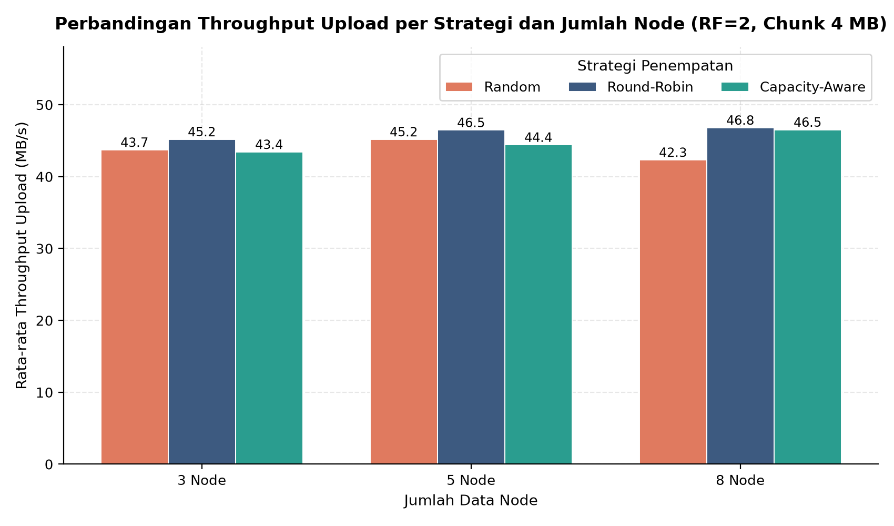
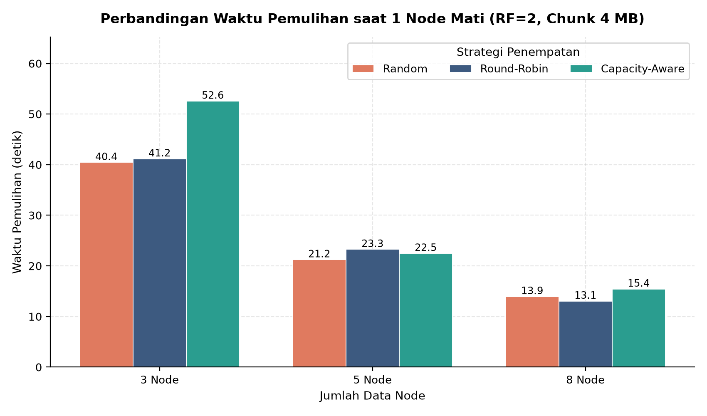

# Hasil Eksperimen SiliFS: Perbandingan Strategi Penempatan Replika

Dokumen ini menyajikan hasil eksperimen perbandingan tiga strategi penempatan replika (**Random**, **Round-Robin**, dan **Capacity-Aware**) terhadap keseimbangan beban (*load balance*), kinerja upload, dan waktu pemulihan (*recovery time*) pada sistem berkas terdistribusi SiliFS.

---

## 1. Metodologi dan Konfigurasi Eksperimen

- **Konfigurasi beban utama**: 100 file biner acak berukuran 50 MB per file (total 5.000 MB data logis), *replication factor* `RF = 2`, ukuran chunk `4 MB` (13 chunk per file → 1.300 chunk unik atau **2.600 replika** per skenario).
- **Variabel uji**:
  - Strategi penempatan: `random` (`rnd`), `round_robin` (`rr`), dan `capacity_aware` (`cap`).
  - Ukuran klaster: `3`, `5`, dan `8` data node (total 9 skenario).
  - Kapasitas virtual tiap data node: `8192 MB` (`--capacity-mb 8192`).
- **Lingkungan eksekusi**: Seluruh container (`master`, `datanode1..N`, `client`) dijalankan pada satu host Windows menggunakan Docker Desktop (Docker versi `29.9.2`) melalui Docker Compose (`deploy/dockerCompose.yml`, `dockerCompose.5.yml`, `dockerCompose.8.yml`). Sebelum setiap skenario, klaster dibersihkan total dengan `docker compose ... down -v`.
- **Simulasi kegagalan dan pengukuran**: Setelah 100 file selesai diunggah dan jumlah chunk per node dicatat, `node2` (`silifs-datanode2`) dihentikan paksa dengan `docker kill`. Waktu deteksi dihitung dari timestamp host saat `docker kill` selesai hingga log `NODE MATI terdeteksi: node2` di master; waktu pemulihan diambil dari log `PEMULIHAN SELESAI` yang dicatat master sejak deteksi hingga seluruh chunk milik `node2` selesai direplikasi ulang secara sekuensial.
- **Penyesuaian `HEARTBEAT_TIMEOUT` (10 s → 30 s)**: Pada percobaan awal dengan `HEARTBEAT_TIMEOUT = 10` detik, beban I/O disk yang tinggi saat re-replication pada satu host menyebabkan heartbeat beberapa node yang masih hidup terlambat melampaui 10 detik. Hal ini memicu *false-positive* deteksi node mati pada node lain (`node1`, `node3`, `node6`, `node7`) sehingga terjadi re-replication ganda atau baris pemulihan `0/0 chunk` yang mengacaukan pengukuran. Untuk menjaga validitas pengukuran pada lingkungan host tunggal, `HEARTBEAT_TIMEOUT` di `master/server.py` dinaikkan dari `10` menjadi `30` detik (tanpa mengubah logika re-replication sekuensial), image Docker dibangun ulang, dan seluruh 9 skenario dijalankan ulang dari awal. Dengan `HEARTBEAT_TIMEOUT = 30` detik, tidak ada satu pun *false-positive* node mati pada ke-9 skenario.

---

## 2. Tabel Ringkasan Hasil

Seluruh 9 skenario menghasilkan 100/100 upload berhasil (`ok=True`), total tepat 2.600 replika per skenario, dan 100% chunk milik `node2` berhasil dipulihkan tanpa kegagalan replikasi. Standar deviasi (`Std Chunk`) dihitung sebagai standar deviasi populasi (`ddof=0`) atas seluruh $N$ data node pada klaster, dan koefisien variasi `CV = Std / Mean`.

| Skenario | Strategi | Node | Throughput Upload (MB/s) | Latensi Chunk (ms) | Mean Chunk/Node | Std Chunk | CV | Max–Min Chunk | Waktu Deteksi (s) | Waktu Pemulihan (s) | Chunk Dipulihkan |
|---|---|---:|---:|---:|---:|---:|---:|---:|---:|---:|---:|
| `rnd_rf2_c4_n3` | Random | 3 | 43,72 | 31,93 | 866,67 | 8,01 | 0,0092 | 17 | 29,734 | 40,441 | 861/861 |
| `rr_rf2_c4_n3` | Round-Robin | 3 | 45,19 | 30,52 | 866,67 | 0,47 | 0,0005 | 1 | 29,702 | 41,163 | 866/866 |
| `cap_rf2_c4_n3` | Capacity-Aware | 3 | 43,43 | 32,30 | 866,67 | 1,25 | 0,0014 | 3 | 28,026 | 52,578 | 867/867 |
| `rnd_rf2_c4_n5` | Random | 5 | 45,18 | 30,43 | 520,00 | 11,23 | 0,0216 | 34 | 29,874 | 21,230 | 517/517 |
| `rr_rf2_c4_n5` | Round-Robin | 5 | 46,47 | 29,39 | 520,00 | 0,00 | 0,0000 | 0 | 27,849 | 23,273 | 520/520 |
| `cap_rf2_c4_n5` | Capacity-Aware | 5 | 44,42 | 30,90 | 520,00 | 3,79 | 0,0073 | 11 | 31,400 | 22,485 | 521/521 |
| `rnd_rf2_c4_n8` | Random | 8 | 42,32 | 32,61 | 325,00 | 11,95 | 0,0368 | 33 | 28,865 | 13,950 | 311/311 |
| `rr_rf2_c4_n8` | Round-Robin | 8 | 46,80 | 29,18 | 325,00 | 0,87 | 0,0027 | 2 | 27,342 | 13,050 | 325/325 |
| `cap_rf2_c4_n8` | Capacity-Aware | 8 | 46,52 | 29,26 | 325,00 | 1,22 | 0,0038 | 3 | 28,108 | 15,438 | 323/323 |

Sumber data mentah: [summary.csv](../experiments/data/summary.csv), [load_balance.csv](../experiments/data/load_balance.csv), dan [recovery.csv](../experiments/data/recovery.csv).

---

## 3. Analisis dan Interpretasi Grafik

### 3.1 Throughput Upload per Strategi

- **Fakta dari data**: Rata-rata throughput upload berada pada rentang sempit **42,32–46,80 MB/s** di seluruh 9 skenario (rata-rata latensi per chunk `29,18–32,61 ms`). **Round-Robin** mencatat throughput tertinggi di setiap ukuran klaster (`45,19 MB/s` pada 3 node, `46,47 MB/s` pada 5 node, dan `46,80 MB/s` pada 8 node). Pada 8 node, **Capacity-Aware** (`46,52 MB/s`) hampir menyamai Round-Robin, sedangkan **Random** (`42,32 MB/s`) menjadi yang terendah.
- **Dugaan penyebab**: Selisih antar strategi relatif kecil (~1–4,5 MB/s) karena seluruh data node berjalan di satu host fisik dengan disk dan CPU yang sama, serta alur upload dari sisi client mengirim file satu per satu secara sekuensial. Kemungkinan penurunan ringan pada `rnd_rf2_c4_n8` disebabkan fluktuasi beban latar belakang host atau ketidakseimbangan sementara penulisan ke node tertentu saat pengacakan.

### 3.2 Keseimbangan Beban (Standar Deviasi Jumlah Chunk)

- **Fakta dari data**:
  - **Round-Robin** paling merata di semua ukuran klaster: `std = 0,47` (`max-min = 1`) pada 3 node, `std = 0,00` (`max-min = 0`, tepat 520 chunk per node) pada 5 node, dan `std = 0,87` (`max-min = 2`) pada 8 node.
  - **Capacity-Aware** berada di posisi kedua dengan sebaran sangat dekat dengan Round-Robin: `std = 1,25` (`max-min = 3`) pada 3 node, `std = 3,79` (`max-min = 11`) pada 5 node, dan `std = 1,22` (`max-min = 3`) pada 8 node.
  - **Random** memiliki ketimpangan terbesar pada semua ukuran klaster, dengan standar deviasi meningkat dari `8,01` (3 node, `CV = 0,92%`, `max-min = 17`) menjadi `11,23` (5 node, `CV = 2,16%`, `max-min = 34`) dan `11,95` (8 node, `CV = 3,68%`, `max-min = 33`).
- **Dugaan penyebab**: Round-Robin menggeser pointer pemilihan node secara deterministik per chunk sehingga setiap node menerima jumlah chunk hampir identik (tepat sama bila 2.600 habis dibagi jumlah node, seperti pada 5 node). Capacity-Aware memilih node berdasarkan `free_bytes` terbesar yang diperbarui melalui heartbeat berkala; jeda pembaruan heartbeat antar upload diduga menyebabkan sedikit ketidakseimbangan (`max-min` 3–11 chunk) dibanding Round-Robin. Sementara itu, Random memilih secara seragam tanpa memori alokasi sebelumnya sehingga variasi alami distribusi binomial/multinomial tetap muncul dan koefisien variasinya makin terlihat saat jumlah node bertambah.

### 3.3 Waktu Pemulihan saat 1 Node Mati

- **Fakta dari data**:
  - Waktu deteksi kegagalan `node2` konsisten di kisaran **27,34–31,40 detik** di seluruh skenario (sejalan dengan `HEARTBEAT_TIMEOUT = 30` detik).
  - Waktu pemulihan menurun drastis seiring bertambahnya jumlah node:
    - **3 node** (861–867 chunk): Random `40,441 s`, Round-Robin `41,163 s`, Capacity-Aware `52,578 s`.
    - **5 node** (517–521 chunk): Random `21,230 s`, Capacity-Aware `22,485 s`, Round-Robin `23,273 s`.
    - **8 node** (311–325 chunk): Round-Robin `13,050 s`, Random `13,950 s`, Capacity-Aware `15,438 s`.
  - Tidak ada satu strategi yang selalu tercepat di semua ukuran klaster; pada 5 dan 8 node, selisih antar strategi hanya sekitar `2,0–2,4` detik.
- **Dugaan penyebab**: Karena `rereplicate` di `master/server.py` memulihkan chunk satu per satu secara sekuensial, faktor dominan waktu pemulihan adalah **jumlah chunk yang harus disalin ulang** ($\approx 2600 / N$), bukan algoritma penempatannya. Lonjakan waktu pemulihan `cap_rf2_c4_n3` (`52,578 s` dibanding `~41 s` pada Random/Round-Robin untuk jumlah chunk yang hampir sama, 867 vs 866) diduga disebabkan kontensi I/O disk host selama pengulangan tunggal, bukan overhead komputasi pemilihan target Capacity-Aware.

### 3.4 Skalabilitas (Throughput Upload terhadap Jumlah Node)

- **Fakta dari data**: Penambahan jumlah data node dari 3 ke 5 dan 8 node tidak menghasilkan peningkatan throughput upload yang signifikan:
  - Round-Robin naik tipis dari `45,19 MB/s` (3 node) → `46,47 MB/s` (5 node) → `46,80 MB/s` (8 node), atau `+3,6%`.
  - Capacity-Aware naik dari `43,43 MB/s` (3 node) → `44,42 MB/s` (5 node) → `46,52 MB/s` (8 node), atau `+7,1%`.
  - Random naik dari `43,72 MB/s` (3 node) → `45,18 MB/s` (5 node), lalu turun ke `42,32 MB/s` (8 node).
- **Dugaan penyebab**: Dalam topologi satu laptop, seluruh container berbagi satu antarmuka disk fisik dan CPU yang sama. Selain itu, skrip eksperimen menjalankan satu client yang mengunggah file secara berurutan (tidak ada konkurensi multi-client). Akibatnya, bottleneck bukan terletak pada kapasitas masing-masing data node, melainkan pada throughput tulis disk host dan overhead per-file client sehingga penambahan node belum mempercepat upload secara linear. Sebaliknya, manfaat skalabilitas jumlah node terlihat nyata pada **waktu pemulihan** yang turun ~65–70% dari 3 ke 8 node.

---

## 4. Jawaban atas Pertanyaan Penelitian

1. **Strategi mana yang paling seimbang?**
   **Round-Robin** adalah strategi yang paling seimbang pada seluruh ukuran klaster yang diuji (`std` 0,00–0,87 chunk; `CV` ≤ 0,27%; selisih `max-min` 0–2 chunk). **Capacity-Aware** berada di posisi kedua dengan keseimbangan yang juga sangat baik (`std` 1,22–3,79 chunk; `CV` ≤ 0,73%), sedangkan **Random** paling tidak seimbang (`std` 8,01–11,95 chunk; `CV` hingga 3,68%).
2. **Strategi mana yang pemulihannya tercepat?**
   Pada eksperimen 1 pengulangan ini, **tidak ada pemenang mutlak di seluruh ukuran klaster**: Random tercepat pada 3 node (`40,441 s`) dan 5 node (`21,230 s`), sedangkan Round-Robin tercepat pada 8 node (`13,050 s`). Perbedaan antar strategi pada 5 dan 8 node relatif kecil (~2 detik), yang menunjukkan bahwa pada mekanisme re-replication sekuensial, strategi penempatan hanya berpengaruh kecil selama jumlah chunk pada node yang mati relatif setara.
3. **Bagaimana pengaruh jumlah node?**
   - Terhadap **waktu pemulihan**: penambahan node berdampak sangat positif — meningkatkan klaster dari 3 ke 5 dan 8 node memangkas jumlah chunk per node dari ~867 menjadi ~520 dan ~325, sehingga waktu pemulihan turun dari `40,4–52,6 s` menjadi `21,2–23,3 s` (5 node) dan `13,1–15,4 s` (8 node).
   - Terhadap **keseimbangan beban**: pada Random, ketimpangan relatif (`CV`) membesar dari `0,92%` (3 node) menjadi `3,68%` (8 node), sedangkan Round-Robin dan Capacity-Aware tetap stabil rendah (`CV` < 0,75%).
   - Terhadap **throughput upload**: pengaruhnya kecil pada pengujian host tunggal (`42,3–46,8 MB/s`) karena keterbatasan disk bersama dan beban upload sekuensial dari satu client.

---

## 5. Batasan Eksperimen

1. **Eksekusi pada satu laptop (single-host Docker)**: Seluruh container berjalan di satu mesin fisik (Docker `29.9.2`) dengan jaringan bridge lokal, sehingga latensi jaringan antar node sangat kecil dan semua node memperebutkan CPU serta disk fisik yang sama. Angka throughput dan waktu pemulihan tidak dapat langsung disamakan dengan klaster fisik multi-mesin.
2. **Kapasitas virtual homogen**: Seluruh data node dikonfigurasi dengan kapasitas virtual identik (`8192 MB`), sehingga **Capacity-Aware** tidak menghadapi node dengan kapasitas berbeda atau node yang hampir penuh untuk dihindari. Keunggulan khas Capacity-Aware pada klaster heterogen belum teruji dalam rangkaian ini.
3. **Strategi Random tanpa seed tetap**: Implementasi `random` saat ini tidak mengatur `random.seed` tetap, sehingga distribusi chunk acak dan jumlah chunk pada `node2` bervariasi antar eksekusi.
4. **Jumlah pengulangan terbatas**: Dataset utama ini menggunakan **1 pengulangan** per skenario (masing-masing 100 file @ 50 MB, total ~51 menit untuk 9 skenario), sehingga variasi acak akibat aktivitas latar belakang sistem operasi (misalnya `cap_rf2_c4_n3` sebesar `52,578 s`) belum dirata-ratakan dari beberapa kali uji.
5. **Pengukuran waktu deteksi**: Waktu deteksi diukur dari timestamp host saat perintah `docker kill` selesai hingga timestamp log `NODE MATI terdeteksi` di master. Nilai ini mencakup jeda polling `monitor_loop` (interval 2 detik) serta sedikit perbedaan waktu eksekusi antara perintah `docker kill` dan detak heartbeat terakhir sebelum container berhenti, sehingga hasil berkisar `27,34–31,40 s` di sekitar `HEARTBEAT_TIMEOUT = 30 s`.
