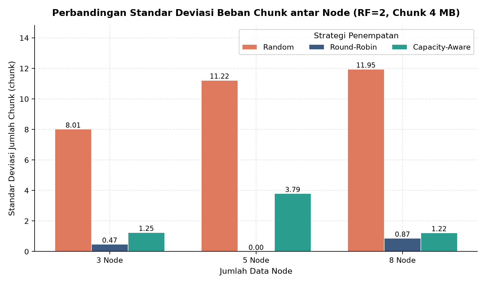
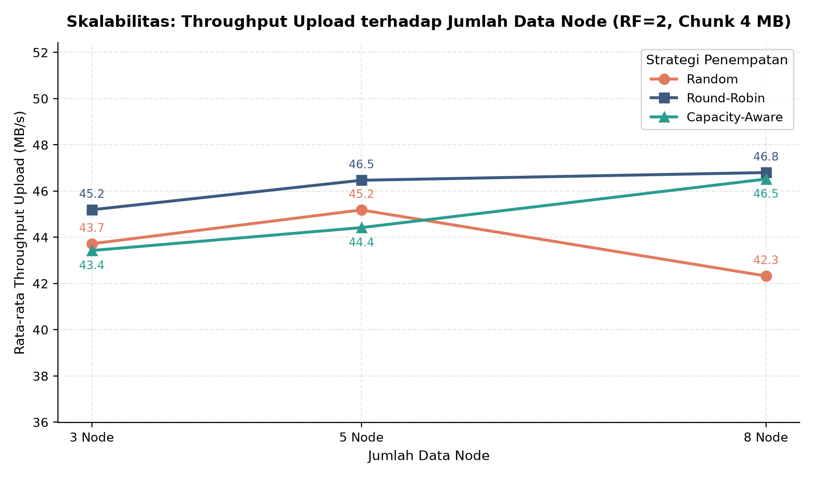
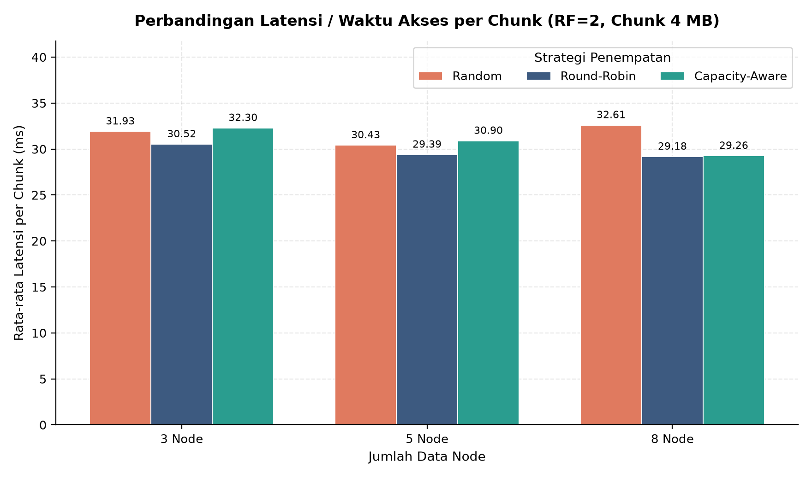
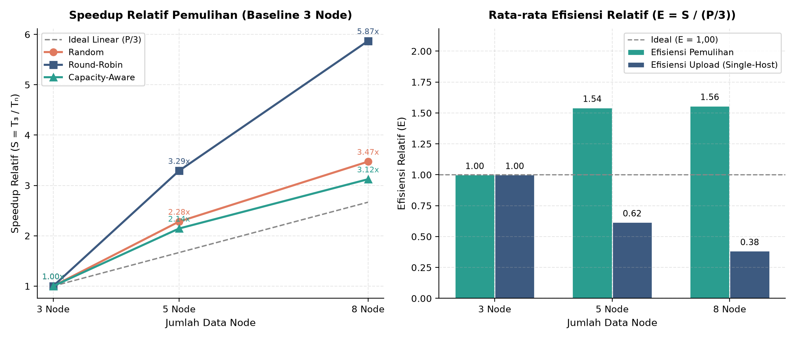
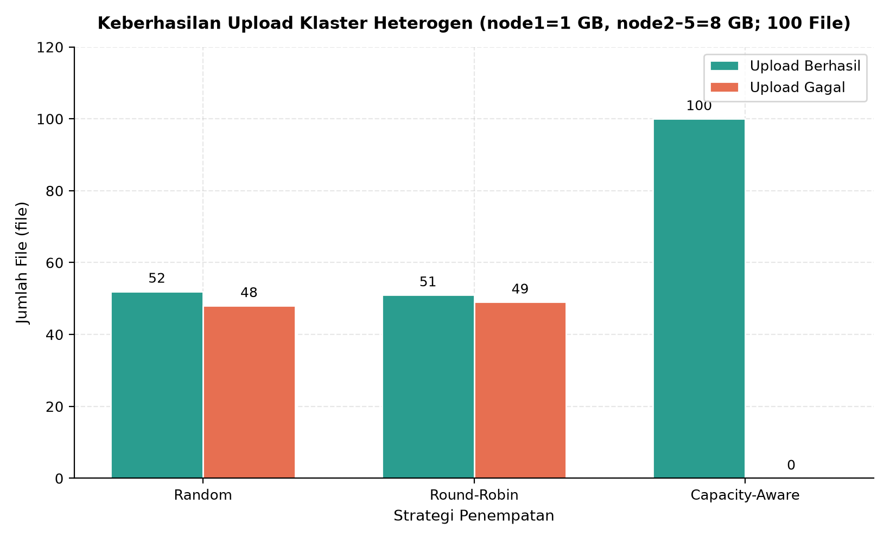
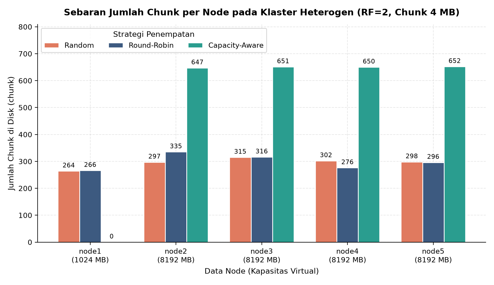

# Hasil Eksperimen SiliFS: Perbandingan Strategi Penempatan Replika

Dokumen ini menyajikan hasil eksperimen perbandingan tiga strategi penempatan replika (**Random**, **Round-Robin**, dan **Capacity-Aware**) terhadap keseimbangan beban (*load balance*), kinerja upload, ketahanan kapasitas heterogen, dan waktu pemulihan (*recovery time*) pada sistem berkas terdistribusi SiliFS.

---

## 1. Metodologi dan Lingkungan Eksperimen

- **Lingkungan host**:
  - Spesifikasi fisik laptop: `AMD Ryzen 5 5500U with Nvidia GeForce RTX 3050` (versi Windows: `Windows 11 Pro`).
  - Engine Docker: Docker Desktop versi `29.9.2` (alokasi engine tercatat via `docker info`: `12` vCPU, `7,44 GiB` RAM).
- **Konfigurasi beban utama (homogen)**: 100 file biner acak berukuran 50 MB per file (total 5.000 MB data logis), *replication factor* `RF = 2`, ukuran chunk `4 MB` (13 chunk per file → 1.300 chunk unik atau **2.600 replika** per skenario).
  - Strategi: `random` (`rnd`), `round_robin` (`rr`), `capacity_aware` (`cap`).
  - Ukuran klaster: `3`, `5`, dan `8` data node (`deploy/dockerCompose.yml`, `dockerCompose.5.yml`, `dockerCompose.8.yml`), masing-masing `--capacity-mb 8192`.
- **Konfigurasi kapasitas heterogen**: 5 data node (`deploy/dockerCompose.hetero.yml`), dengan `node1` berkapasitas `--capacity-mb 1024` dan `node2..node5` berkapasitas `--capacity-mb 8192`, beban 100 file @ 50 MB, `RF = 2`, chunk `4 MB`. Node yang dimatikan adalah `node2` (kapasitas 8192 MB, bukan `node1` yang kecil) agar pengujian pemulihan adil bagi ketiga strategi.
- **Konfigurasi pengulangan**: 2 run tambahan (`_run2` dan `_run3`, total **3 pengulangan**) untuk konfigurasi `3 node` pada seluruh 3 strategi guna mengevaluasi variasi waktu pemulihan. Konfigurasi `5 node` dan `8 node` masih berjumlah 1 pengulangan (`n=1`).
- **Simulasi kegagalan & kebersihan klaster**: Sebelum tiap skenario/run, klaster dibersihkan total dengan `docker compose ... down -v`. Setelah upload selesai dan jumlah chunk per node dicatat, `node2` dihentikan paksa dengan `docker kill`. Waktu deteksi dihitung dari timestamp host saat `docker kill` selesai hingga log `NODE MATI terdeteksi: node2` di master; waktu pemulihan diambil dari log `PEMULIHAN SELESAI` di master.
- **Penyesuaian `HEARTBEAT_TIMEOUT` (10 s → 30 s)**: Pada percobaan awal dengan `HEARTBEAT_TIMEOUT = 10` detik, beban I/O disk tinggi saat re-replication di satu host menyebabkan heartbeat beberapa node yang masih hidup terlambat >10 detik sehingga memicu *false-positive* deteksi node mati (`node1`, `node3`, `node6`, `node7`) dan menghasilkan baris pemulihan `0/0 chunk` atau re-replication ganda. `HEARTBEAT_TIMEOUT` di `master/server.py` dinaikkan menjadi `30` detik (tanpa mengubah logika re-replication sekuensial), image Docker dibangun ulang, dan seluruh rangkaian eksperimen dijalankan dari awal. Dengan timeout `30` detik, **tidak terjadi satu pun *false-positive* node mati** pada seluruh 18 eksekusi (9 utama + 3 heterogen + 6 pengulangan `n=3`).

---

## 2. Hasil Eksperimen Utama (Klaster Homogen, 9 Skenario)

Seluruh 9 skenario utama menghasilkan 100/100 upload berhasil (`ok=True`), tepat 2.600 replika per skenario, dan 100% chunk milik `node2` berhasil dipulihkan tanpa error. Standar deviasi beban (`Std Chunk`) dihitung sebagai standar deviasi populasi (`ddof=0`) atas seluruh $N$ data node, dan koefisien variasi `CV = Std / Mean`.

| Skenario | Strategi | Node | Throughput Upload (MB/s) | Latensi Chunk (ms) | Mean Chunk/Node | Std Chunk | CV | Max–Min Chunk | Waktu Deteksi (s) | Waktu Pemulihan (s) | Chunk Dipulihkan |
|---|---|---:|---:|---:|---:|---:|---:|---:|---:|---:|---:|
| `rnd_rf2_c4_n3` | Random | 3 | 43,72 | 31,93 | 866,67 | 8,01 | 0,0092 | 17 | 29,734 | 40,441 | 861/861 |
| `rr_rf2_c4_n3` | Round-Robin | 3 | 45,19 | 30,52 | 866,67 | 0,47 | 0,0005 | 1 | 29,702 | 41,163 | 866/866 |
| `cap_rf2_c4_n3` | Capacity-Aware | 3 | 43,43 | 32,30 | 866,67 | 1,25 | 0,0014 | 3 | 28,026 | 52,578 | 867/867 |
| `rnd_rf2_c4_n5` | Random | 5 | 45,18 | 30,43 | 520,00 | 11,23 | 0,0216 | 34 | 29,874 | 21,230 | 517/517 |
| `rr_rf2_c4_n5` | Round-Robin | 5 | 46,47 | 29,39 | 520,00 | 0,00 | 0,0000 | 0 | 27,849 | 23,273 | 520/520 |
| `cap_rf2_c4_n5` | Capacity-Aware | 5 | 44,42 | 30,90 | 520,00 | 3,79 | 0,0073 | 11 | 31,400 | 22,485 | 521/521 |
| `rnd_rf2_c4_n8` | Random | 8 | 42,32 | 32,61 | 325,00 | 11,95 | 0,0368 | 33 | 28,865 | 13,950 | 311/311 |
| `rr_rf2_c4_n8` | Round-Robin | 8 | 46,80 | 29,18 | 325,00 | 0,87 | 0,0027 | 2 | 27,342 | 13,050 | 325/325 |
| `cap_rf2_c4_n8` | Capacity-Aware | 8 | 46,52 | 29,26 | 325,00 | 1,22 | 0,0038 | 3 | 28,108 | 15,438 | 323/323 |

Sumber data: [summary.csv](../experiments/data/summary.csv), [load_balance.csv](../experiments/data/load_balance.csv), dan [recovery.csv](../experiments/data/recovery.csv).

### 2.1 Throughput Upload per Strategi

- **Fakta dari data**: Pada run utama, rata-rata throughput upload berada di rentang sempit `42,32–46,80 MB/s` (rata-rata latensi per chunk `29,18–32,61 ms`). Round-Robin mencatat angka tertinggi pada run utama di ketiga ukuran klaster (`45,19`, `46,47`, `46,80 MB/s`). Namun, pada pengulangan `n=3` (Bagian 3), throughput antar run berfluktuasi dengan simpangan baku `3,86–6,07 MB/s`.
- **Dugaan penyebab**: Selisih antar strategi relatif kecil karena seluruh container berbagi satu disk fisik dan CPU yang sama serta client mengunggah file secara sekuensial; fluktuasi antar run diduga berasal dari aktivitas latar belakang sistem operasi host.

### 2.2 Keseimbangan Beban (Standar Deviasi Jumlah Chunk)

- **Fakta dari data**:
  - **Round-Robin** paling merata di semua ukuran klaster: `std = 0,47` (`max-min = 1`) pada 3 node, `std = 0,00` (`max-min = 0`, tepat 520 chunk/node) pada 5 node, dan `std = 0,87` (`max-min = 2`) pada 8 node.
  - **Capacity-Aware** berada di posisi kedua: `std = 1,25` (`max-min = 3`) pada 3 node, `std = 3,79` (`max-min = 11`) pada 5 node, dan `std = 1,22` (`max-min = 3`) pada 8 node.
  - **Random** paling tidak merata: `std = 8,01` (`CV = 0,92%`, `max-min = 17`) pada 3 node, `11,23` (`CV = 2,16%`, `max-min = 34`) pada 5 node, dan `11,95` (`CV = 3,68%`, `max-min = 33`) pada 8 node.
- **Dugaan penyebab**: Round-Robin menggeser pointer pemilihan node secara deterministik per chunk. Capacity-Aware memilih berdasarkan `free_bytes` terbesar yang disinkronkan lewat heartbeat berkala (tiap 3 detik), sehingga jeda pembaruan heartbeat diduga menimbulkan selisih kecil (`max-min` 3–11 chunk). Random memilih seragam tanpa memori alokasi sebelumnya sehingga variasi statistik tetap muncul.

### 2.3 Skalabilitas (Throughput Upload terhadap Jumlah Node)

- **Fakta dari data**: Penambahan jumlah node dari 3 ke 5 dan 8 node tidak menaikkan throughput upload secara linear: Round-Robin `45,19 → 46,47 → 46,80 MB/s` (`+3,6%`), Capacity-Aware `43,43 → 44,42 → 46,52 MB/s` (`+7,1%`), dan Random `43,72 → 45,18 → 42,32 MB/s`.
- **Dugaan penyebab**: Seluruh data node berbagi satu disk fisik dan CPU di host tunggal, sementara skrip pengujian hanya menjalankan satu client secara berurutan (tanpa konkurensi multi-client). Sebaliknya, manfaat penambahan node terlihat jelas pada penurunan jumlah chunk per node dan waktu pemulihan.
- **Catatan pemilihan ukuran klaster `(3, 5, 8)`**: Pengujian skalabilitas memakai 3, 5, dan 8 node (bukan 2, 4, 8, 16) karena dengan `RF = 2`, minimal **3 node** diperlukan agar re-replication memiliki node target pengganti saat 1 node mati, sedangkan batas atas **8 node** menyesuaikan alokasi memori Docker host (~7,44 GiB RAM) agar 16 container tidak menimbulkan kontensi berlebihan pada satu laptop.

### 2.4 Latensi / Waktu Akses per Chunk & Uji Download 100 File (50 MB)

- **Fakta dari data (9 skenario utama)**: Rata-rata waktu akses (*latency*) penulisan per chunk 4 MB berada pada rentang sempit **`29,18–32,61 ms/chunk`** di seluruh 9 skenario (`Round-Robin` terendah pada setiap ukuran klaster: `30,52`, `29,39`, dan `29,18 ms/chunk`).
- **Fakta dari uji tambahan Upload + Download 100 File @ 50 MB** (`rr`, `RF=2`, chunk `4 MB`, 3 node; sumber: [upload_download_100_rr_rf2_c4_n3.csv](../experiments/data/upload_download_100_rr_rf2_c4_n3.csv)):

| Operasi (3 Node, Round-Robin, RF=2) | Jumlah File Berhasil | Durasi Rata-rata (s/file) | Throughput Rata-rata (MB/s) | Latensi Chunk Rata-rata (ms) |
|---|---:|---:|---:|---:|
| Upload (100 file × 50 MB) | **100 / 100** | 1,69 ± 0,43 | 30,95 ± 6,03 | 46,18 ± 13,14 |
| Download (100 file × 50 MB) | **100 / 100** | **0,76 ± 0,43** | **74,90 ± 18,75** | 51,93 ± 32,49 |

- **Dugaan penyebab**: Throughput download (`74,90 MB/s`) tercatat ~2,4× lebih tinggi dibanding upload (`30,95 MB/s`) pada sesi yang sama karena operasi download hanya membaca **1 replika** per chunk (tanpa menulis ganda `RF = 2` ke disk dan memanfaatkan *page cache* sistem operasi).

### 2.5 Analisis Speedup dan Efficiency Relatif

Karena konfigurasi `RF = 2` dengan pengujian re-replication membutuhkan minimal 3 node, **Speedup relatif** dihitung terhadap baseline klaster terkecil $P_{\text{base}} = 3$ node dengan faktor skala $P / 3$: $S_{\text{rel}} = T_3 / T_P$ dan $E_{\text{rel}} = S_{\text{rel}} / (P / 3)$ (untuk waktu pemulihan $n=3$ digunakan rata-rata 3 pengulangan dari `summary_ulang.csv`). Sumber data: [speedup_efficiency.csv](../experiments/data/speedup_efficiency.csv).

| Strategi | Node ($P$) | Faktor Skala ($P/3$) | Speedup Upload ($S_{\text{up}}$) | Efisiensi Upload ($E_{\text{up}}$) | Speedup Pemulihan ($S_{\text{rec}}$) | Efisiensi Pemulihan ($E_{\text{rec}}$) |
|---|---:|---:|---:|---:|---:|---:|
| Random | 3 | 1,00 | 1,00× | 1,00 | 1,00× | 1,00 |
| Random | 5 | 1,67 | 1,03× | 0,62 | 2,28× | 1,37 |
| Random | 8 | 2,67 | 0,97× | 0,36 | 3,47× | 1,30 |
| Round-Robin | 3 | 1,00 | 1,00× | 1,00 | 1,00× | 1,00 |
| Round-Robin | 5 | 1,67 | 1,03× | 0,62 | 3,29× | 1,98 |
| Round-Robin | 8 | 2,67 | 1,04× | 0,39 | 5,87× | 2,20 |
| Capacity-Aware | 3 | 1,00 | 1,00× | 1,00 | 1,00× | 1,00 |
| Capacity-Aware | 5 | 1,67 | 1,02× | 0,61 | 2,14× | 1,29 |
| Capacity-Aware | 8 | 2,67 | 1,07× | 0,40 | 3,12× | 1,17 |

- **Fakta dari data**:
  - **Upload**: Speedup relatif hampir datar (`0,97–1,07×`), sehingga efisiensi relatif turun dari `1,00` (3 node) menjadi `~0,62` (5 node) dan `~0,38` (8 node).
  - **Pemulihan**: Speedup relatif meningkat tajam hingga `2,14–3,29×` (5 node) dan `3,12–5,87×` (8 node), melampaui faktor skala linear `P/3` (`E > 1,00`).
- **Dugaan penyebab**: Pada upload, efisiensi menurun seiring $P$ sesuai hukum Amdahl karena bottleneck disk tunggal host dan eksekusi satu client sekuensial. Pada pemulihan, speedup super-linear (`E > 1`) diduga berasal dari berkurangnya jumlah chunk yang dipulihkan per node ($\approx 2600/P$) sekaligus berkurangnya tekanan I/O berkepanjangan pada 2 node tersisa (khususnya pada baseline `rr_n3` yang memiliki lonjakan waktu pemulihan pada run 2–3).

---

## 3. Pengulangan Waktu Pemulihan (`n=3`, 3 Pengulangan)

Untuk menguji kestabilan waktu pemulihan, dilakukan 3 pengulangan penuh (`run1`, `_run2`, `_run3`) pada klaster 3 node (total 9 run). Simpangan baku antar run dihitung sebagai simpangan baku sampel (`ddof=1`). Sumber data: [summary_ulang.csv](../experiments/data/summary_ulang.csv).

| Konfigurasi | Jumlah Run (`n`) | Pemulihan per Run (s) | Waktu Pemulihan (Mean ± SD) | Waktu Deteksi (Mean ± SD) | Throughput Upload (Mean ± SD) | Rata-rata Chunk Dipulihkan |
|---|---:|---|---:|---:|---:|---:|
| `rnd_rf2_c4_n3` | 3 | `40,44` / `47,54` / `57,36` | **48,44 ± 8,49 s** | 29,22 ± 0,77 s | 39,27 ± 3,86 MB/s | 850,3 |
| `rr_rf2_c4_n3` | 3 | `41,16` / `102,46` / `86,20` | **76,61 ± 31,75 s** | 29,18 ± 0,54 s | 38,19 ± 6,07 MB/s | 866,7 |
| `cap_rf2_c4_n3` | 3 | `52,58` / `52,46` / `39,61` | **48,22 ± 7,46 s** | 29,46 ± 1,42 s | 40,72 ± 5,04 MB/s | 866,0 |
| `rnd_rf2_c4_n5` | 1 | `21,23` | 21,23 s *(n=1)* | 29,87 s | 45,18 MB/s | 517,0 |
| `rr_rf2_c4_n5` | 1 | `23,27` | 23,27 s *(n=1)* | 27,85 s | 46,47 MB/s | 520,0 |
| `cap_rf2_c4_n5` | 1 | `22,49` | 22,49 s *(n=1)* | 31,40 s | 44,42 MB/s | 521,0 |
| `rnd_rf2_c4_n8` | 1 | `13,95` | 13,95 s *(n=1)* | 28,87 s | 42,32 MB/s | 311,0 |
| `rr_rf2_c4_n8` | 1 | `13,05` | 13,05 s *(n=1)* | 27,34 s | 46,80 MB/s | 325,0 |
| `cap_rf2_c4_n8` | 1 | `15,44` | 15,44 s *(n=1)* | 28,11 s | 46,52 MB/s | 323,0 |

- **Fakta dari data**:
  - Pada **3 node (`n=3` run)**, simpangan baku waktu pemulihan sangat besar: Random `48,44 ± 8,49 s`, Capacity-Aware `48,22 ± 7,46 s`, dan Round-Robin `76,61 ± 31,75 s` (dengan rentang `41,16–102,46 s` meski seluruh 867/867 chunk pulih tanpa error dan tanpa *false-positive* node mati). Karena simpangan baku besar dan interval saling tumpang tindih, **waktu pemulihan antar strategi pada `n=3` tidak dapat disimpulkan berbeda secara bermakna**.
  - Pada **5 node** (`21,23–23,27 s`) dan **8 node** (`13,05–15,44 s`), data baru berasal dari **1 pengulangan (`n=1`)**, sehingga **tidak ada klaim perbandingan waktu pemulihan antar strategi** pada kedua ukuran klaster tersebut.
  - Faktor yang jelas memengaruhi waktu pemulihan adalah **jumlah node** (yang menentukan jumlah chunk yang harus dipulihkan per node mati): ~850–867 chunk pada 3 node (`~40–102 s`) turun menjadi ~517–521 chunk pada 5 node (`~21–23 s`) dan ~311–325 chunk pada 8 node (`~13–15 s`).
- **Dugaan penyebab**: Re-replication di `master/server.py` berjalan sekuensial satu chunk demi satu chunk, sehingga waktu pemulihan terutama sebanding dengan jumlah chunk yang disalin. Lonjakan Round-Robin pada `run2` (`102,46 s`) dan `run3` (`86,20 s`) merupakan **dugaan** kontensi I/O disk atau beban latar belakang host selama eksekusi panjang, bukan fakta keunggulan/kelemahan algoritma Round-Robin.

---

## 4. Skenario Kapasitas Heterogen (`node1=1024 MB`, `node2..node5=8192 MB`)

Untuk menguji keunggulan Capacity-Aware pada klaster tidak seragam, dijalankan skenario 5 node dengan `node1` berkapasitas kecil (`1024 MB`) dan `node2..node5` berkapasitas `8192 MB` (`RF = 2`, chunk `4 MB`, 100 file @ 50 MB). Node yang dimatikan adalah `node2`. Sumber data: [upload_status.csv](../experiments/data/upload_status.csv), [hetero_capacity.csv](../experiments/data/hetero_capacity.csv), dan [recovery.csv](../experiments/data/recovery.csv).

| Skenario | Strategi | Upload Berhasil | Upload Gagal | `node1` di Disk (chunk / free) | Total Chunk di Disk (termasuk yatim) | Chunk Yatim (*Orphan*) | Pemulihan `node2` (berhasil / total) | Tingkat Keberhasilan Pemulihan | Waktu Pemulihan* (s) |
|---|---|---:|---:|---|---:|---:|---:|---:|---:|
| `rnd_rf2_c4_n5_het` | Random | **52** | **48** | 264 chunk / `0,00 MB` | 1.476 | 124 | 198 / 258 | **76,7%** | 11,444* |
| `rr_rf2_c4_n5_het` | Round-Robin | **51** | **49** | 266 chunk / `0,00 MB` | 1.489 | 163 | 221 / 265 | **83,4%** | 12,110* |
| `cap_rf2_c4_n5_het` | Capacity-Aware | **100** | **0** | 0 chunk / `1024,00 MB` | 2.600 | 0 | 647 / 647 | **100,0%** | 34,478* |

*\*Catatan penting: waktu pemulihan antar strategi pada skenario heterogen **tidak sebanding** secara langsung karena jumlah chunk yang dipulihkan sangat berbeda (`198`, `221`, dan `647` chunk). Demikian pula, jumlah file tersimpan berbeda (`52`, `51`, dan `100` file) sehingga throughput upload dan standar deviasi sebaran antar strategi tidak dibandingkan langsung. Metrik yang bermakna pada skenario ini adalah **tingkat keberhasilan upload** dan **tingkat keberhasilan pemulihan**.*

*Keterangan Grafik 06: angka yang ditampilkan adalah total file chunk di disk masing-masing node (`ls /app/data/nodeN`), **termasuk chunk yatim (orphan chunks)** dari upload gagal yang belum di-commit (`124` chunk yatim pada Random, `163` pada Round-Robin, dan `0` pada Capacity-Aware).*

- **Fakta dari data**:
  - **Capacity-Aware** mencapai **100/100 upload berhasil (0 gagal)** dengan `node1` tidak terpakai (`0` chunk, sisa `1024 MB`) dan seluruh 2.600 replika tersebar sangat merata pada `node2..node5` (`647, 651, 650, 652` chunk; masing-masing menyisakan `5690–5694 MB`). Saat `node2` mati, **647/647 chunk (100%)** berhasil dipulihkan.
  - **Random** hanya berhasil mengunggah **52/100 file** (gagal mulai `f053.bin`) dan **Round-Robin** hanya **51/100 file** (gagal mulai `f052.bin`) setelah `node1` mencapai batas `1024,00 MB` (`0,00 MB` tersisa).
  - Terdapat **chunk yatim** pada Random (`1.476 - 1.352 = 124` chunk) dan Round-Robin (`1.489 - 1.326 = 163` chunk) karena upload gagal tidak melakukan *rollback*.
  - Saat `node2` mati, Random hanya memulihkan **198/258 chunk (`76,7%`, 60 gagal)** dan Round-Robin hanya **221/265 chunk (`83,4%`, 44 gagal)**; tidak ada peringatan node lain mati pada ketiga skenario.
- **Dugaan penyebab (terkonfirmasi dari kode)**:
  - Di `master/placement.py`, `CapacityAwarePlacement` mengurutkan node berdasarkan `free_bytes` menurun dan langsung mengurangi `node.free_bytes -= chunk_size` secara lokal. Karena `node2..node5` selalu memiliki sisa >5.690 MB (>1.024 MB milik `node1`), `node1` tidak pernah terpilih baik saat upload maupun re-replication.
  - Sebaliknya, `RandomPlacement` dan `RoundRobinPlacement` tidak memeriksa `free_bytes`, sehingga terus mengalokasikan chunk ke `node1` yang sudah penuh — baik saat upload (ditolak `datanode` dengan `Disk capacity exceeded`) maupun saat re-replication (ditolak `ReplicateChunk` dengan `ok=False`, yang dilewati tanpa log error dan tanpa *retry* di `master/server.py`).

---

## 5. Jawaban atas Pertanyaan Penelitian

1. **Strategi mana yang paling seimbang?**
   Pada klaster homogen, **Round-Robin** paling seimbang (`std` `0,00–0,87` chunk; `CV` ≤ `0,27%`), diikuti ketat oleh **Capacity-Aware** (`std` `1,22–3,79` chunk; `CV` ≤ `0,73%`), sedangkan **Random** paling tidak merata (`std` `8,01–11,95` chunk; `CV` hingga `3,68%`). Pada klaster heterogen (`node1` 1 GB), **Capacity-Aware** adalah satu-satunya strategi yang mampu menghindari node berkapasitas kecil dan menjaga 100% keberhasilan upload (`100/100`) serta 100% keberhasilan pemulihan (`647/647`).
2. **Strategi mana yang pemulihannya tercepat?**
   **Tidak dapat disimpulkan ada satu strategi yang paling cepat pemulihannya.** Pada `n=3` dengan 3 pengulangan, variasi antar run sangat besar (`Random 48,4 ± 8,5 s`, `Capacity-Aware 48,2 ± 7,5 s`, `Round-Robin 76,6 ± 31,8 s`), sementara `n=5` dan `n=8` baru memiliki 1 pengulangan. Pada klaster heterogen, waktu pemulihan tidak sebanding karena jumlah chunk yang dipulihkan berbeda jauh.
3. **Bagaimana pengaruh jumlah node?**
   Penambahan jumlah node (3 → 5 → 8) secara konsisten memangkas jumlah chunk per node (~867 → ~520 → ~325) dan **mempercepat waktu pemulihan secara drastis** (dari ~40–102 s menjadi ~21–23 s dan ~13–15 s). Terhadap throughput upload di host tunggal, pengaruhnya kecil karena bottleneck disk bersama dan client sekuensial.

---

## 6. Bonus Kubernetes (`kind`) — Hasil Uji Fungsional

Manifest Kubernetes di [deploy/k8s/](../deploy/k8s/README.md) (`master.yaml`, `datanode.yaml` StatefulSet dengan PVC 2 GiB, `client-job.yaml`) telah diuji pada `kind v0.33.0` (`kindest/node:v1.37.0`) menggunakan image `silifs:latest`:

- **Fakta hasil uji**:
  - Keempat pod (`master`, `datanode-0..2`) mencapai status `1/1 Running` dan ketiganya terdaftar di master (`datanode-0..2.datanode:50052`).
  - `Job` `silifs-smoke-test` berhasil mengunggah file acak `50 MB` (`4,13 s`, `12,10 MB/s`, `RF=2`, `round_robin`) dan mengunduhnya kembali (`3,73 s`, `13,41 MB/s`) dengan hash SHA-256 identik (`4a66d1c4...85476c`).
  - `kubectl delete pod datanode-1` membuktikan *self-healing* `StatefulSet`: pod dibuat ulang dalam hitungan detik dengan PVC yang sama dan langsung mendaftar ulang ke master.
  - `kubectl scale statefulset datanode --replicas=5` berhasil menambah klaster menjadi 5 data node (`datanode-0..4` semua `1/1 Running` dan terdaftar di master).
  - Cluster dibersihkan kembali setelah pengujian (`kind delete cluster --name silifs`).
- **Batasan**: Pengujian `kind` hanya bertujuan memverifikasi fungsionalitas *deployment*, *self-healing* pod, dan *scaling* `StatefulSet` (bukan benchmark performa karena seluruh pod dan PVC tetap berjalan di satu laptop). Selain itu, karena restart pod `StatefulSet` jauh lebih cepat dari `HEARTBEAT_TIMEOUT = 30 s` (dan `terminationGracePeriodSeconds` bawaan pod sebesar 30 s), simulasi re-replication penuh tetap mengacu pada eksperimen Docker Compose.

---

## 7. Batasan Eksperimen

1. **Eksekusi satu laptop (single-host Docker)**: Seluruh container berjalan di satu host fisik (Docker `29.9.2`, spesifikasi fisik `AMD Ryzen 5 5500U with Nvidia GeForce RTX 3050`) dengan jaringan bridge lokal, sehingga latensi jaringan sangat kecil dan seluruh node memperebutkan CPU serta disk fisik yang sama.
2. **Kapasitas homogen pada 9 skenario utama**: Pada rangkaian 9 skenario utama, seluruh node memakai `--capacity-mb 8192`; keunggulan Capacity-Aware baru tampak ketika diuji pada skenario heterogen (`node1=1024 MB`).
3. **Strategi Random tidak di-seed**: Tanpa `random.seed` tetap, distribusi chunk dan jumlah chunk di `node2` berbeda antar eksekusi.
4. **Jumlah pengulangan terbatas**: Pengulangan 3× baru dilakukan pada konfigurasi `n=3`; konfigurasi `n=5`, `n=8`, dan heterogen baru 1 pengulangan (`n=1`).
5. **Pengukuran waktu deteksi**: Diukur dari timestamp host saat `docker kill` selesai hingga log `NODE MATI terdeteksi` di master (mencakup jeda polling `monitor_loop` 2 detik dan jitter penjadwalan), menghasilkan rentang `27,34–31,40 s` di sekitar `HEARTBEAT_TIMEOUT = 30 s`.

---

## 8. Pekerjaan Lanjutan (*Future Work*)

Berdasarkan temuan eksperimen dan inspeksi kode tanpa mengubah arsitektur inti saat ini, perbaikan yang direkomendasikan untuk pengembangan berikutnya meliputi:

1. **Paralelisasi dan *retry* pada re-replication**: Saat ini `rereplicate` di `master/server.py` menyalin chunk secara sekuensial satu per satu; selain itu, kegagalan `ReplicateChunk` yang mengembalikan `ok=False` (mis. karena disk target penuh) dilewati secara senyap tanpa log peringatan dan tanpa *retry* ke node kandidat lain.
2. **Rollback upload gagal / pembersihan *orphan chunks***: Ketika upload file gagal di tengah jalan (seperti pada skenario heterogen Random/Round-Robin), chunk yang sudah terlanjur ditulis ke data node lain tidak dihapus sehingga menumpuk sebagai chunk yatim di disk. Diperlukan mekanisme *rollback* atau *garbage collector* periodik.
3. **Penghapusan replika berlebih (*over-replication cleanup*)**: Ketika node yang sempat dianggap mati kembali hidup (`node hidup kembali`), replika lama di node tersebut tidak dibersihkan meskipun master sudah membuat replika baru di node lain, sehingga jumlah replika melebihi RF.
4. **Reproduksibilitas strategi Random**: Menambahkan parameter seed opsional (`random.seed`) pada `RandomPlacement` agar eksperimen acak dapat direproduksi persis antar pengujian.
5. **Ketersediaan tinggi Master (*Single Master*)**: Sistem saat ini memakai satu master tunggal (*single point of failure*) dengan metadata di memori; pengembangan lanjutan dapat menambahkan persistensi metadata atau replikasi master (mis. Raft).
